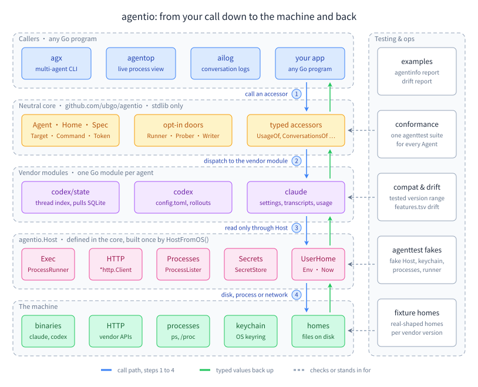

<h1 align="center">agentio</h1>
<p align="center"><strong>Typed Go access to Claude Code, OpenAI Codex and other coding-agent CLIs.</strong></p>
<p align="center">Find every install and home, read settings, MCP servers, skills, plugins, logins, plan usage, conversations and live sessions, and build the command that launches or resumes the agent, from one type-safe Go library.</p>

<p align="center">
  
  <a href="LICENSE"></a>
</p>

agentio is an open-source Go library that tells a program everything it can know about the coding-agent CLIs on a machine: whether **Claude Code** and **OpenAI Codex** are installed and at which version, where their homes (config directories) are, what is in their settings, `CLAUDE.md` / `AGENTS.md` instruction files, MCP servers, skills and plugins, which account is logged in, how much of the plan's usage is left, which conversations exist and which sessions are running right now. It also builds the exact `Command` that launches, resumes or runs an agent headless, with the right environment for each home. It reads local files through typed structs modelled on real vendor files, never runs a vendor binary or touches the network unless you ask, and never refreshes or prints a login token.

## Contents

- [Why agentio?](#why-agentio)
- [Architecture](#architecture)
- [Install](#install)
- [Quick start](#quick-start)
- [What you can read and build](#what-you-can-read-and-build)
- [Documentation](#documentation)
- [Examples](#examples)
- [FAQ](#faq)
- [Contributing](#contributing)
- [Security](#security)
- [License](#license)

## Why agentio?

Every tool that sits next to a coding agent (a launcher, a usage meter, a session switcher, a dashboard, a backup script) ends up re-learning the same vendor facts: where `~/.claude` and `~/.codex` live and how a second home is selected, how Claude Code names its per-folder history directory, which keychain entry holds the login, which file holds cached usage, how a Codex rollout is laid out, which flags exist in which version. Each tool gets a few of them wrong (a hard-coded home path, a token on argv, a whole transcript read into memory) and each breaks separately when the vendor ships a change.

agentio puts those facts in one tested library, with each vendor fact backed by a fixture home copied from a real install:

- **Type-safe all the way down.** Concrete vendor types (`*claude.Agent`, `*codex.Agent`) when you know the agent; one typed accessor per shared capability (`agentio.UsageOf(a)`, `agentio.ConversationsOf(a)`) when you loop over agents. No `any`, no string-keyed features, no type assertions in your code.
- **Every call states its cost.** Pure, disk read, process run, network read or quota-spending call. Running a vendor binary, spending quota and writing sit behind separate doors (`Runner`, `Prober`, `Writer`), so a read-only loop cannot do any of them by accident.
- **Safe with credentials.** Tokens are a redacting `Token` type that prints `[redacted]` everywhere, never go on argv, and are never refreshed or written. Emails and account ids are redacted too unless you call `Reveal()`.
- **Read-only by default.** Writes are explicit `Writer` methods that back the target up first and return what they copied.
- **No hidden state.** Everything (home dir, environment, clock, HTTP, keychain, process table, exec) comes from one `Host` value, so tests point it at fixture homes and one process can inspect several homes side by side.
- **Multiple homes are first class.** Default home, `CLAUDE_CONFIG_DIR` / `CODEX_HOME` homes and any extra home directory, with the vendor's own env rule applied when launching.
- **Pay only for what you import.** One Go module per vendor: a Claude-only program never downloads Codex's TOML or SQLite dependencies.
- **Version drift is visible.** Each vendor module declares the CLI versions it was tested against; anything outside the range still works and returns a warning. A drift report lists unknown keys, enum values and flags on a real machine.
- **Agents as data.** A simple CLI agent (binary, home variable, resume syntax) is an `agentio.Spec` value, no Go code needed.

| | **agentio** | Parsing vendor files yourself | Shelling out to vendor subcommands |
|---|---|---|---|
| Typed structs for settings, MCP, usage, conversations | ✅ | ⚠️ you write and maintain them | ⚠️ only what the CLI prints as JSON |
| Same code loops over Claude Code and Codex | ✅ typed accessors | ❌ | ❌ |
| Never runs a vendor binary unless asked | ✅ | ✅ | ❌ |
| Never refreshes or rewrites a login | ✅ invariant with tests | ⚠️ depends on care | ❌ some subcommands refresh tokens |
| Tokens kept off argv, logs and JSON | ✅ redacting types | ⚠️ depends on care | ⚠️ depends on care |
| Multiple homes per agent | ✅ | ⚠️ often hard-coded to the default | ⚠️ one env var at a time |
| Testable without a real account | ✅ `Host` + fixture homes + fakes | ⚠️ | ❌ |
| Tracks vendor version drift | ✅ tested ranges, warnings, drift report | ❌ | ❌ |

If you only need one value from one file once, reading it yourself is fine. If your program needs to understand several agents, several homes or several vendor versions, and must not leak or break a login, use agentio.

## Architecture



The library has three levels:

- **L1 core** (`agentio.Agent`): what every agent has, including one described only by data: identity, homes, binary lookup and building a launch `Command`.
- **L2 shared capabilities**: concepts both vendors share (install, identity, usage, cached usage, subscription, conversations, prompt history, live sessions, turns, instruction files, MCP servers, skills, plugins, config layers, run events, doctor checks), each a small interface with a typed accessor such as `agentio.UsageOf(a)`.
- **L3 vendor API**: everything else, typed per vendor: Claude Code settings, hooks, subagents, transcripts and stream-json events; Codex `config.toml`, rollouts, SQLite threads and exec events.

## Install

agentio is a set of Go modules. Import only the ones you need:

| Module | Import when you need | Extra dependencies |
|---|---|---|
| `github.com/ubgo/agentio` | the neutral core: `Host`, `Agent`, `Command`, `Token`, capability accessors, `agenttest` | none (stdlib only) |
| `github.com/ubgo/agentio/claude` | Claude Code | none |
| `github.com/ubgo/agentio/codex` | Codex: config, rollouts, usage, sessions, launch | `github.com/pelletier/go-toml/v2` |
| `github.com/ubgo/agentio/codex/state` | Codex's SQLite stores (threads, turns, goals, memories, logs), read-only | `modernc.org/sqlite` (pure Go, no CGO) |
| `github.com/ubgo/agentio/builtin` | every built-in agent at once, plus config-defined agents | whatever `claude` and `codex` pull |

```sh
# Claude Code only
go get github.com/ubgo/agentio/claude

# Codex only
go get github.com/ubgo/agentio/codex

# Every built-in agent in one typed set
go get github.com/ubgo/agentio/builtin

# Codex SQLite stores: only if you read threads or logs from SQLite
go get github.com/ubgo/agentio/codex/state
```

`codex/state` is its own module because it pulls a full SQLite driver. Most programs never need it: `codex` already reads Codex's rollouts, config and usage. `builtin` does not import `codex/state` either.

agentio needs Go 1.26.4 or newer and builds with `CGO_ENABLED=0` on linux, macOS and windows (amd64 and arm64).

## Quick start

This program lists every Claude Code and Codex home on the machine, the three newest conversations in each, the cached plan usage, and the command that would start Claude Code in plan mode. It only reads disk; it runs no vendor binary and makes no network call.

```go
package main

import (
	"context"
	"fmt"
	"log"

	"github.com/ubgo/agentio"
	"github.com/ubgo/agentio/builtin"
	"github.com/ubgo/agentio/claude"
)

func main() {
	ctx := context.Background()

	// The only call that touches the real machine.
	host, err := agentio.HostFromOS()
	if err != nil {
		log.Fatal(err)
	}
	agents, err := builtin.New(host) // Claude Code + Codex; nothing read yet
	if err != nil {
		log.Fatal(err)
	}

	// Neutral loop: every agent, every home, capabilities by typed accessor.
	for _, a := range agents.All() {
		homes, err := a.Homes() // disk read
		if err != nil {
			log.Fatal(err)
		}
		for _, h := range homes {
			fmt.Println(a.Name(), h.Dir())
			if conv, ok := agentio.ConversationsOf(a); ok {
				list, err := conv.Conversations(ctx, h, agentio.ConversationQuery{Limit: 3})
				if err != nil {
					log.Fatal(err)
				}
				for _, c := range list {
					fmt.Printf("  %s  %s\n", c.Updated.Format("2006-01-02"), c.Title)
				}
			}
			if cu, ok := agentio.CachedUsageOf(a); ok {
				u, found, err := cu.CachedUsage(h) // disk only, safe in a loop
				if err == nil && found {
					fmt.Printf("  plan usage: %.0f%% (as of %s)\n", u.MaxPercent(), u.ObservedAt.Format("15:04"))
				}
			}
		}
	}

	// Vendor API: code that knows it is Claude Code gets typed options.
	cmd, err := agents.Claude.Launch(agents.Claude.DefaultHome().Target(), claude.LaunchOptions{
		Model:          "opus",
		PermissionMode: claude.ModePlan,
	})
	if err != nil {
		log.Fatal(err)
	}
	fmt.Println(cmd.Redacted()) // building is pure; you run it
}
```

Run against the repository's fixture homes (two Claude Code homes and one Codex home), it prints:

```text
Claude Code /home/user/.claude
  2026-11-14  Fixture title 185
  2026-11-14  Fixture title 166
  plan usage: 6% (as of 08:38)
Claude Code /home/user/.claude-work
  2026-11-14  Work home fixture
Codex /home/user/.codex
  2026-11-14  List the files
  2026-11-14  hello
  plan usage: 12% (as of 10:00)
claude --model opus --permission-mode plan
```

A Claude-only program skips `builtin` and uses `claude.New(host)` directly; `c.Neutral()` gives the same neutral view for the L2 accessors.

## What you can read and build

| Area | Claude Code | Codex |
|---|---|---|
| Install, version, tested range, binary lookup | ✅ | ✅ |
| Homes: default, env-selected, extra dirs | ✅ | ✅ |
| Settings and config layers | ✅ `settings.json` scopes, hooks, env, policy limits | ✅ `config.toml`, profiles |
| Instruction files | ✅ `CLAUDE.md`, imports, auto memory | ✅ `AGENTS.md` |
| MCP servers, skills, plugins | ✅ | ✅ |
| Account identity and subscription | ✅ (personal values redacted) | ✅ (personal values redacted) |
| Plan usage: cached on disk or live from the vendor | ✅ | ✅ |
| Conversations, prompt history, turns | ✅ transcripts, read with bounded head and tail | ✅ rollouts, SQLite threads via `codex/state` |
| Live sessions and process classification | ✅ | ✅ |
| Launch, resume, headless commands | ✅ typed `LaunchOptions`, stream-json decoder | ✅ typed options, exec event decoder |
| Explicit writes with backup | ✅ settings, hooks, move history and conversations, link homes | ❌ by design: Codex keeps its own stores consistent, so changes go through Codex's own commands |

The full list, with the cost of every call, is in the [feature index](docs/reference/features.md).

## Documentation

- [Learning path](docs/README.md#learning-path): read the docs in order, from the first `Host` to vendor-specific APIs.
- [Choosing guides](docs/choosing/README.md): which module, which level, which door for your program.
- [Feature index](docs/reference/features.md): every capability and method with its cost.
- [All docs](docs/README.md): getting started, core, capabilities, Claude Code, Codex, testing, compatibility.
- [CHANGELOG](CHANGELOG.md): release history per module.

## Examples

Runnable programs live in [`examples/`](examples/), one per area, each with a README and a test that runs it on fixture homes; the full list is in [All examples](docs/README.md#all-examples). Two of them report on your own machine:

- `examples/agentinfo`: a text or `--json` report of every agent and home on the machine: install, compat, homes, paths, settings, MCP servers, instruction files, skills, plugins, identity (redacted), cached usage, recent conversations, live sessions. Disk and process-table reads only unless you pass `--runner` or `--network`.
- `examples/drift`: lists what the library does not know yet about the vendor versions on this machine (unknown keys, enum values, record types, flags), naming files and keys only, never values.

```sh
cd examples
go run ./agentinfo
```

## FAQ

### How do I read Claude Code or Codex settings and config from Go?

Create a `Host` with `agentio.HostFromOS()`, then `claude.New(host)` or `codex.New(host)`. The vendor agent has typed readers for Claude Code's `settings.json` scopes and Codex's `config.toml`, and `agentio.ConfigOf(a)` gives a neutral view of both.

### Does agentio send data anywhere or need an API key?

No. By default it only reads local files and, for live sessions, the process table. Live usage and subscription calls are separate network methods you call explicitly, and the only quota-spending call sits behind the `Prober` door.

### Can it break my Claude Code or Codex login?

It is designed not to. agentio never refreshes, writes or copies an OAuth token, and never runs a vendor binary unless you call a `Runner` method, because some vendor subcommands refresh tokens and rewrite login files. The default home is launched with the home variable removed, not set, so the CLI keeps finding its keychain entry.

### How do I get Claude Code or Codex plan usage (5-hour and weekly limits) in Go?

`agentio.CachedUsageOf(a)` reads the usage the CLI last saved on disk, which is free and safe in a loop. `agentio.UsageOf(a)` or `c.Usage(ctx, home)` asks the vendor once over the network; a 429 comes back as `ErrRateLimited`, so cache the result instead of polling.

### Does it support several Claude Code accounts or config directories?

Yes. `a.Homes()` finds the default home and other home directories on disk, each launch targets one home, and the vendor's env rule (`CLAUDE_CONFIG_DIR`, `CODEX_HOME`) is applied for you.

### How do I list Claude Code conversations or Codex sessions?

`agentio.ConversationsOf(a)` lists conversations per home, newest first, filtered by folder, time or count. Claude Code transcripts are never read whole, only a bounded head and tail. For Codex's SQLite threads, import `codex/state`.

### Which Claude Code and Codex versions are supported?

Each vendor module declares the range it was tested against (`claude.TestedMin` / `TestedMax`, `codex.TestedMin` / `TestedMax`) with a fixture home per version. Other versions still work: unknown keys are kept in typed `Unknown` fields and the result carries a warning instead of failing.

### Can I add an agent other than Claude Code and Codex?

A simple CLI agent can be described as data with an `agentio.Spec` and passed to `builtin.New(host, spec)`; it gets homes, binary lookup, launch and doctor checks. Full vendor support (usage, conversations) needs a vendor module, modelled on a real install.

### How do I test code that uses agentio without a real account?

Build a `Host` with `agenttest.NewHost` and point it at a copy of a fixture home, with fake keychain, process table and exec runner, and an `httptest` server for network calls. `agenttest.Conformance` checks any `agentio.Agent` against the library's invariants.

## Contributing

Contributions are welcome. Read [CONTRIBUTING.md](CONTRIBUTING.md) for the multi-module setup, `task check`, and the rules every change keeps (real vendor shapes only, type-safe APIs, no hidden state, fixtures instead of real accounts).

## Security

Report vulnerabilities privately as described in [SECURITY.md](SECURITY.md), which also lists the library's guarantees for tokens and other secrets.

## License

[Apache License 2.0](LICENSE).
