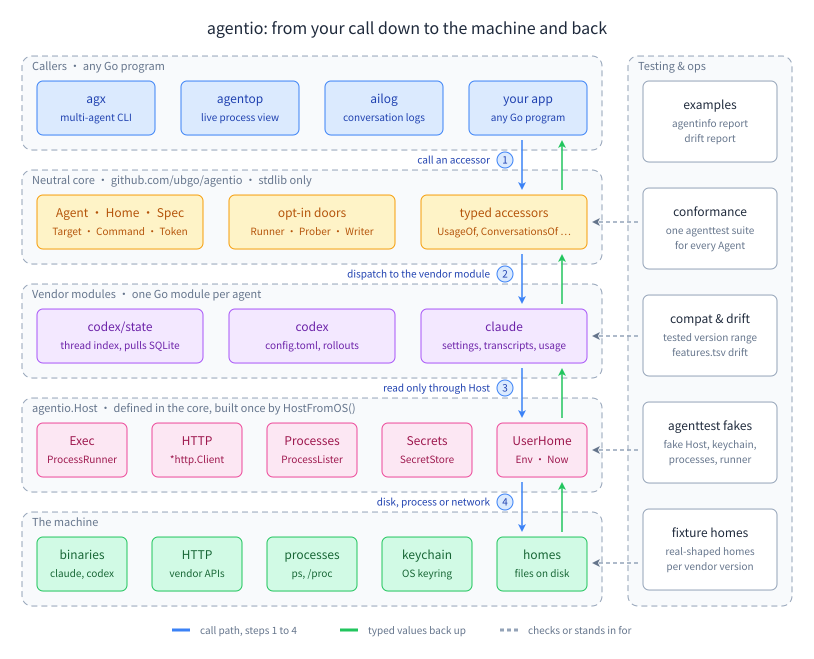

# agentio documentation

agentio is a typed Go library for coding-agent CLIs. It tells your program everything it can know about Claude Code and OpenAI Codex on a machine (install and version, homes, settings, MCP servers, instruction files, skills, plugins, login, plan usage, conversations, live sessions) and builds the command that launches or resumes them. These pages teach it step by step: every guide has complete snippets that compile, the exact output of a runnable example, and the traps taken from the code and tests.

New here? Follow the [learning path](#learning-path). Know what you want to build? Jump to [start from your goal](#start-from-your-goal). Looking for one function? Use the [feature index](reference/features.md).

The library has three levels. **L1 core** (`agentio.Agent`, `Host`, `Home`, `Command`, `Token`) is what every agent has, including one described only by data. **L2 shared capabilities** are concepts both vendors share (usage, conversations, live sessions, config, MCP, skills), each a small interface reached through a typed accessor such as `agentio.UsageOf(a)`. **L3 vendor API** is everything else, typed per vendor in the `claude` and `codex` modules. Calls that run a binary, spend quota or write files sit behind separate doors (`Runner`, `Prober`, `Writer`).

## Learning path

Read these in order. Each step names what you learn, the guide that teaches it, and an example you can run from the `examples/` folder with `go run ./<name>`. All examples run on fixture homes checked into the repository: no real account, binary or network.

| # | You learn | Guide | Example |
|---|---|---|---|
| 1 | Which module to add for the agents you need, and what each one pulls | [Install agentio](getting-started/install.md), [Which module to import](choosing/modules.md) | [quickstart](../examples/quickstart/) |
| 2 | The first program: `agentio.HostFromOS()`, `claude.New(host)`, `Install()` and `Homes()` | [Your first agent](getting-started/first-agent.md) | [quickstart](../examples/quickstart/) |
| 3 | Why everything goes through one `Host`, and how to build one by hand for tests or a second machine view | [Host](core/host.md#step-2--build-a-host-by-hand) | [quickstart](../examples/quickstart/) |
| 4 | Homes: the default home, `CLAUDE_CONFIG_DIR` / `CODEX_HOME` homes, extra folders, and the owner check | [Homes](core/homes.md) | [homes](../examples/homes/) |
| 5 | The vendor API through the concrete type: Claude Code settings layers and their merge, Codex `config.toml` | [The Claude agent](claude/agent.md), [Claude settings](claude/settings.md), [Codex config.toml](codex/config.md) | [claudesettings](../examples/claudesettings/), [codexconfig](../examples/codexconfig/) |
| 6 | Building launch, resume and headless commands, the autonomy guard and the child environment rule per home | [Targets and commands](core/launch.md), [Claude launch](claude/launch.md), [Codex launch](codex/launch.md) | [launch](../examples/launch/), [claudelaunch](../examples/claudelaunch/), [codexlaunch](../examples/codexlaunch/) |
| 7 | Tokens that never print, redacted personal values, and the error sentinels to branch on | [Tokens and redacted values](core/secrets.md), [Errors](core/errors.md) | [launch](../examples/launch/), [values](../examples/values/) |
| 8 | Looping over every agent with typed accessors, `Supported` and `Unsupported`, and what each capability costs | [Built-in agents](capabilities/builtin.md), [Shared capabilities and accessors](capabilities/accessors.md), [Concrete type or accessor](choosing/concrete-or-accessor.md) | [accessors](../examples/accessors/) |
| 9 | Plan usage for every account: cached from disk in loops, live from the vendor on demand; then pick the account with the most headroom | [Usage and subscription](capabilities/usage.md), [Live or cached usage](choosing/live-or-cached-usage.md), [Pick the home with the most headroom](capabilities/pick.md) | [usage](../examples/usage/), [pick](../examples/pick/) |
| 10 | Conversations, turns, prompt history, and which sessions are running right now | [Conversations](capabilities/conversations.md), [Live sessions](capabilities/live-sessions.md) | [conversations](../examples/conversations/), [livesessions](../examples/livesessions/) |
| 11 | The doors: running the binary, spending quota, writing settings with a backup, linking a new home | [Doors](capabilities/doors.md), [Which door](choosing/doors.md), [Writes: file or vendor command](choosing/writes.md) | [doors](../examples/doors/), [claudehooks](../examples/claudehooks/) |
| 12 | Adding another CLI agent as data with an `agentio.Spec`; the other built-in agents (Gemini CLI, pi) and what each supports | [Config-defined agents](capabilities/fromspec.md), [Built-in or config-defined](choosing/builtin-or-config-agent.md), [Gemini CLI](gemini/README.md), [pi](pi/README.md), [Capability matrix](reference/capability-matrix.md) | [fromspec](../examples/fromspec/), [gemini](../examples/gemini/), [pi](../examples/pi/), [capmatrix](../examples/capmatrix/) |
| 13 | Version safety: tested ranges, per-feature version checks, and the drift report for new vendor releases | [Tested vendor versions](compat/compat.md), [Per-feature version table](compat/features.md), [Drift check](compat/drift.md) | [compat](../examples/compat/), [drift](../examples/drift/) |
| 14 | What differs on macOS, Linux and Windows, and how each is tested | [Platforms](platforms.md) | [agentinfo](../examples/agentinfo/) (`-fixtures`) |
| 15 | The production setup under test: inject the `Host`, use fixture homes, fakes and an `httptest` server, run the conformance suite | [Testing your own code](testing/your-code.md), [Fakes and fixture hosts](testing/agenttest.md), [Fixture homes](testing/fixtures.md), [Conformance](testing/conformance.md) | [testing](../examples/testing/) |

After step 14 you have the shape of a production tool: one `HostFromOS()` in `main`, `builtin.New` for the agent set, accessor loops for the overview, concrete vendor types for vendor detail, every risky call behind a door, a compat check that warns on untested versions, and tests that run on fixtures. The vendor sections below go deeper into each area.

## Start from your goal

| I want to | Read | Run |
|---|---|---|
| Pick the best account (most headroom) and launch on it | [Pick the home with the most headroom](capabilities/pick.md) | [pick](../examples/pick/) |
| Show plan usage for every account | [Usage: cached](capabilities/usage.md#step-1--read-cached-usage), [Live or cached usage](choosing/live-or-cached-usage.md) | [usage](../examples/usage/) |
| Show Claude Code's extra usage or per-model limits | [Claude plan usage](claude/usage.md#step-3--read-extra-usage) | [claudeusage](../examples/claudeusage/) |
| Launch or resume an agent on a chosen home | [Launch through the neutral Agent](core/launch.md#step-2--launch-through-the-neutral-agent), [Claude resume](claude/launch.md#step-2--resume-a-conversation), [Codex start and resume](codex/launch.md#step-1--start-and-resume) | [launch](../examples/launch/), [claudelaunch](../examples/claudelaunch/), [codexlaunch](../examples/codexlaunch/) |
| Run an agent headless and decode its events | [Run events](capabilities/run-events.md), [Claude stream decoding](claude/stream.md), [Codex exec events](codex/exec.md) | [runevents](../examples/runevents/), [claudestream](../examples/claudestream/) |
| Launch with a token in CI, without a stored login | [Launch with a token](capabilities/logins.md#step-2--launch-with-a-token), [Claude token environment](claude/credential.md#step-3--build-a-token-environment) | [usage](../examples/usage/), [claudeaccount](../examples/claudeaccount/) |
| List conversations of every home | [List conversations](capabilities/conversations.md#step-1--list-conversations) | [conversations](../examples/conversations/) |
| Read a Claude transcript's last reply or cost without reading it whole | [Claude transcripts](claude/transcript.md#step-3--read-the-last-assistant-reply) | [claudeconversations](../examples/claudeconversations/) |
| Read Codex threads from its SQLite index | [Codex SQLite state](codex/state.md#step-2--list-threads) | [codexstate](../examples/codexstate/) |
| Detect running agents and map a PID to its session | [Live sessions](capabilities/live-sessions.md#step-3--find-the-session-of-a-pid) | [livesessions](../examples/livesessions/) |
| See who is logged in, on which plan | [Read the signed-in identity](capabilities/install-identity.md#step-3--read-the-signed-in-identity) | [accessors](../examples/accessors/), [claudeaccount](../examples/claudeaccount/), [codexaccount](../examples/codexaccount/) |
| Read hooks | [Claude hooks](claude/hooks.md#step-1--list-configured-hooks), [Codex hooks](codex/hooks-rules.md#step-1--read-hook-config) | [claudehooks](../examples/claudehooks/), [codexconfig](../examples/codexconfig/) |
| Write a hook or status-line program | [Decode hook input](claude/hooks.md#step-2--decode-hook-input), [Decode status line input](claude/statusline.md#step-2--decode-status-line-input) | [claudehooks](../examples/claudehooks/) |
| Install a hook safely, with a backup | [Add a hook](claude/writer.md#step-2--add-a-hook), [Writes: file or vendor command](choosing/writes.md) | [claudehooks](../examples/claudehooks/) |
| Install one capture hook into Claude Code, Codex and Gemini CLI, and decode its payload | [Hooks: install and decode](capabilities/hooks.md) | [hooks](../examples/hooks/) |
| Read effective settings and where each key came from | [Claude effective settings](claude/settings.md#step-2--read-the-effective-settings), [Codex effective config](codex/config.md#step-2--read-the-effective-config) | [claudesettings](../examples/claudesettings/), [codexconfig](../examples/codexconfig/) |
| List MCP servers, skills and plugins across agents | [Config, MCP, skills and plugins](capabilities/config.md#step-2--list-mcp-servers) | [accessors](../examples/accessors/), [claudeextensions](../examples/claudeextensions/) |
| Add an MCP server or plugin the vendor's way | [Claude MCP commands](claude/mcp.md#step-3--build-add-and-remove-commands), [Codex MCP commands](codex/mcp.md#step-2--build-add-and-remove-commands) | [claudeextensions](../examples/claudeextensions/), [codexconfig](../examples/codexconfig/) |
| Set up a second home that shares settings and skills | [Link shared home files](capabilities/doors.md#step-4--link-shared-home-files) | [doors](../examples/doors/) |
| Move conversations to another home | [Plan a move](core/backup-move-link.md#step-2--plan-a-move), [Claude conversations: plan a move](claude/conversations.md#step-4--plan-a-move) | [backupmove](../examples/backupmove/) |
| Run a health check for a home | [Doctor checks](capabilities/doctor.md), [Claude doctor](claude/doctor.md), [Codex doctor](codex/doctor.md) | [accessors](../examples/accessors/), [claudelaunch](../examples/claudelaunch/) |
| Warn when the installed CLI is newer than tested | [Check the installed version](compat/compat.md#step-2--check-the-installed-version) | [compat](../examples/compat/) |
| Refuse a flag the installed version does not have | [Handle FeatureUnavailableError](compat/features.md#step-3--handle-featureunavailableerror) | [compat](../examples/compat/) |
| Find what the library does not know yet about a new vendor release | [Drift check](compat/drift.md) | [drift](../examples/drift/) |
| Support a new agent from config | [Config-defined agents](capabilities/fromspec.md), [Built-in or config-defined](choosing/builtin-or-config-agent.md) | [fromspec](../examples/fromspec/) |
| Validate a launcher's `--option`, settings and `-c` keys, and plan a switchable login | [Typed launch configuration](capabilities/launch-config.md) | [launchconfig](../examples/launchconfig/) |
| Read Gemini CLI or pi homes, settings and conversations | [Gemini CLI](gemini/README.md), [pi](pi/README.md) | [gemini](../examples/gemini/), [pi](../examples/pi/) |
| Test my code without real homes | [Testing your own code](testing/your-code.md), [Fixture homes](testing/fixtures.md) | [testing](../examples/testing/) |
| Check my own `agentio.Agent` against the library's rules | [The conformance suite](testing/conformance.md) | [testing](../examples/testing/) |

## All pages

Every guide follows the same shape: what it is and when you want it, what you need before you start, numbered steps with complete snippets, the exact output of the example, pitfalls, and related pages.

### Getting started

Install the modules, build a `Host`, create your first agent.

| Page | Steps | Examples |
|---|---|---|
| [Install agentio](getting-started/install.md) | Add the module you need; check that it builds | — |
| [Your first agent](getting-started/first-agent.md) | Build a Host; create the Claude agent; read the install; list the homes | [quickstart](../examples/quickstart/) |

### Core (L1)

The neutral types every agent shares: `Host`, `Agent`, `Spec`, homes, launch commands, tokens, errors and values.

| Page | Steps | Examples |
|---|---|---|
| [Host: the only door to the machine](core/host.md) | Build a Host from the OS; build a Host by hand; find a binary on PATH | [quickstart](../examples/quickstart/) |
| [Agent, Spec and Core](core/agent-and-spec.md) | Use the Agent interface; read an agent's Spec; build a Core from a Spec | [quickstart](../examples/quickstart/) |
| [Homes](core/homes.md) | Get the default home; list every home; open a home by folder; check who owns a home | [homes](../examples/homes/) |
| [Targets and commands](core/launch.md) | Build a Target from a home; launch through the neutral Agent; check the autonomy level; change the child environment | [launch](../examples/launch/) |
| [Tokens and redacted values](core/secrets.md) | Wrap a secret in a Token; put a token in a child env; redact personal values | [launch](../examples/launch/) |
| [Errors](core/errors.md) | Match a sentinel; handle rate limits | [values](../examples/values/) |
| [Optional values, unknown keys and warnings](core/values.md) | Read an optional field; find unknown keys; collect warnings | [values](../examples/values/) |
| [Versions](core/versions.md) | Parse a version; compare versions | [values](../examples/values/) |
| [Enums](core/enums.md) | Parse an enum from text; list every value | [values](../examples/values/) |
| [Backups, moves and home links](core/backup-move-link.md) | Back up a file; plan a move; apply a move plan; plan and apply home links | [backupmove](../examples/backupmove/) |

### Shared capabilities (L2)

Concepts both vendors share, each a small interface reached through a typed accessor, plus the doors and agents described as data.

| Page | Steps | Examples |
|---|---|---|
| [Shared capabilities and accessors](capabilities/accessors.md) | Loop over agents with an accessor; list supported capabilities; ask why a capability is missing; check what a capability costs | [accessors](../examples/accessors/) |
| [Built-in agents](capabilities/builtin.md) | Build every agent; find an agent by ID; add config-defined agents | [accessors](../examples/accessors/) |
| [Install, version and identity](capabilities/install-identity.md) | Read the install; run the binary for its version; read the signed-in identity | [accessors](../examples/accessors/) |
| [Usage and subscription](capabilities/usage.md) | Read cached usage; read live usage; read the subscription | [usage](../examples/usage/) |
| [Logins and tokens](capabilities/logins.md) | Build a login command; launch with a token; probe a token | [usage](../examples/usage/) |
| [Conversations, turns and prompt history](capabilities/conversations.md) | List conversations; read turns from an offset; read prompt history; check and move history | [conversations](../examples/conversations/) |
| [Live sessions and processes](capabilities/live-sessions.md) | List live sessions; classify a process; find the session of a PID | [livesessions](../examples/livesessions/) |
| [Config, MCP, instructions, skills, plugins and models](capabilities/config.md) | Read config layers; list MCP servers; list instruction files; list skills and plugins; list models | [accessors](../examples/accessors/) |
| [Run events](capabilities/run-events.md) | Decode a headless run | [runevents](../examples/runevents/) |
| [Doctor checks](capabilities/doctor.md) | Run the checks for a home; check the installed version | [accessors](../examples/accessors/) |
| [Typed launch configuration](capabilities/launch-config.md) | Validate typed options with the registry; type-check settings and hand them to Claude; plan a switchable login; check Codex overrides; clean up run files | [launchconfig](../examples/launchconfig/) |
| [Hooks: install and decode](capabilities/hooks.md) | Plan, apply, and apply again; what the merge keeps; decode the payload; remove | [hooks](../examples/hooks/) |
| [Doors: Runner, Prober and Writer](capabilities/doors.md) | Run the vendor binary through a Runner; spend quota through a Prober; write through a Writer; link shared home files | [doors](../examples/doors/) |
| [Config-defined agents](capabilities/fromspec.md) | Describe the agent as a Spec; build it with FromSpec; launch it; launch with a token login | [fromspec](../examples/fromspec/) |

### Claude Code (L3, `claude` module)

The full typed API of a Claude Code install, its homes and projects.

| Page | Steps | Examples |
|---|---|---|
| [The Claude agent](claude/agent.md) | Create the agent; pick a home; open a project; get the neutral view | [claudesettings](../examples/claudesettings/) |
| [Claude install and updates](claude/install.md) | Read the install; read the last update; build install and update commands | [claudesettings](../examples/claudesettings/) |
| [Claude paths](claude/paths.md) | Get home paths; get project paths; encode a history folder | [claudesettings](../examples/claudesettings/) |
| [Claude settings](claude/settings.md) | Read one settings layer; read the effective settings; read managed and remote settings; list environment variables in effect | [claudesettings](../examples/claudesettings/) |
| [Claude global state (.claude.json)](claude/global-config.md) | Read the global config; read one project's state; list config backups | [claudesettings](../examples/claudesettings/) |
| [Claude permissions](claude/permissions.md) | Read the effective permissions; parse a rule | [claudesettings](../examples/claudesettings/) |
| [Claude policy limits](claude/policy.md) | Read policy limits | [claudesettings](../examples/claudesettings/) |
| [Claude hooks](claude/hooks.md) | List configured hooks; decode hook input; reply from a hook | [claudehooks](../examples/claudehooks/) |
| [Claude status line](claude/statusline.md) | Read the status line setting; decode status line input | [claudehooks](../examples/claudehooks/) |
| [Claude MCP servers](claude/mcp.md) | List MCP servers; find servers that need auth; build add and remove commands | [claudeextensions](../examples/claudeextensions/) |
| [Claude memory files](claude/memory.md) | List memory files; read auto memory; follow imports | [claudeextensions](../examples/claudeextensions/) |
| [Claude skills, slash commands and workflows](claude/skills.md) | List skills; list slash commands; list workflows; parse frontmatter | [claudeextensions](../examples/claudeextensions/) |
| [Claude plugins and marketplaces](claude/plugins.md) | List installed plugins; list marketplaces and the blocklist; read a plugin manifest; build plugin commands | [claudeextensions](../examples/claudeextensions/) |
| [Claude subagents](claude/subagents.md) | List subagent definitions; list subagent runs; pass subagents on the command line | [claudeextensions](../examples/claudeextensions/) |
| [Claude output styles](claude/output-styles.md) | List output styles; check the style a setting names; report broken style files | [claudeextensions](../examples/claudeextensions/) |
| [Claude local data](claude/local-data.md) | Read file history; read shell snapshots and cleanup; read IDE locks and debug logs; read data usage and the changelog | [claudeextensions](../examples/claudeextensions/) |
| [Claude writer: settings and hooks](claude/writer.md) | Patch a settings file; add a hook; remove hooks; move history | [claudehooks](../examples/claudehooks/) |
| [Claude credentials and tokens](claude/credential.md) | Read the credential; detect a token's kind; build a token environment; build login commands | [claudeaccount](../examples/claudeaccount/) |
| [Claude account and identity](claude/account.md) | Read the identity; read the OAuth account; read auth status through the Runner | [claudeaccount](../examples/claudeaccount/) |
| [Claude plan usage](claude/usage.md) | Read live usage; read cached usage; read extra usage; probe a token's usage | [claudeusage](../examples/claudeusage/) |
| [Claude stats](claude/stats.md) | Read the stats cache | [claudeconversations](../examples/claudeconversations/) |
| [Claude conversations](claude/conversations.md) | List conversations; open one conversation; read turns; plan a move | [claudeconversations](../examples/claudeconversations/) |
| [Claude transcripts](claude/transcript.md) | Open a transcript; read the tail; read the last assistant reply; read cost and PR links | [claudeconversations](../examples/claudeconversations/) |
| [Claude prompt history](claude/history.md) | Read prompt history; read pasted content | [claudeconversations](../examples/claudeconversations/) |
| [Claude live sessions and background work](claude/sessions.md) | List live sessions; list agent processes; read jobs and the daemon; read teams and task lists | [claudesessions](../examples/claudesessions/) |
| [Claude stream decoding](claude/stream.md) | Decode a stream-json run; decode a JSON result; convert to neutral run events | [claudestream](../examples/claudestream/) |
| [Claude launch and resume](claude/launch.md) | Build a launch command; resume a conversation; fill the Target version; handle unavailable features | [claudelaunch](../examples/claudelaunch/) |
| [Claude Runner](claude/runner.md) | Read the binary version; list plugins and marketplaces; read background agents and auto mode | [claudelaunch](../examples/claudelaunch/) |
| [Claude doctor](claude/doctor.md) | Run the checks | [claudelaunch](../examples/claudelaunch/) |

### Codex (L3, `codex` and `codex/state` modules)

The full typed API of a Codex install and home, and the read-only SQLite stores.

| Page | Steps | Examples |
|---|---|---|
| [The Codex agent](codex/agent.md) | Create the agent; pick a home; get the neutral view | [codexconfig](../examples/codexconfig/) |
| [Codex install and updates](codex/install.md) | Read the install; read the update cache; run the binary through the Runner | [codexconfig](../examples/codexconfig/) |
| [Codex paths and inventory](codex/paths.md) | Get home paths; list the home inventory | [codexconfig](../examples/codexconfig/) |
| [Codex config.toml](codex/config.md) | Read config.toml; read the effective config; read profiles; build config overrides | [codexconfig](../examples/codexconfig/) |
| [Codex MCP servers](codex/mcp.md) | List MCP servers; build add and remove commands | [codexconfig](../examples/codexconfig/) |
| [Codex instructions, skills and plugins](codex/instructions-skills.md) | List instruction files; list skills; list plugins and marketplaces | [codexconfig](../examples/codexconfig/) |
| [Codex hooks and rules](codex/hooks-rules.md) | Read hook config; decode hook input and notify payloads; read execpolicy rules | [codexconfig](../examples/codexconfig/) |
| [Codex auth, identity and usage](codex/auth-usage.md) | Read the identity; read live usage; read cached usage; build login commands | [codexaccount](../examples/codexaccount/) |
| [Codex conversations and history](codex/conversations.md) | List conversations; read turns; read prompt history; list models | [codexconversations](../examples/codexconversations/) |
| [Codex rollout files](codex/rollout.md) | Open a rollout; read the tail; sum conversation tokens | [codexconversations](../examples/codexconversations/) |
| [Codex live sessions and processes](codex/sessions.md) | List live sessions; read thread-writer locks; list processes and chat processes | [codexsessions](../examples/codexsessions/) |
| [Codex launch, resume and exec](codex/launch.md) | Start and resume; run exec headless; build archive, delete and queue commands; handle unavailable features | [codexlaunch](../examples/codexlaunch/) |
| [Codex exec event decoding](codex/exec.md) | Decode exec events; convert to neutral run events | [codexlaunch](../examples/codexlaunch/) |
| [Codex doctor](codex/doctor.md) | Run the checks | [codexconfig](../examples/codexconfig/) |
| [Codex SQLite state (codex/state)](codex/state.md) | Open the state database; list threads; read turns and items; read goals, queue, memories and logs | [codexstate](../examples/codexstate/) |

### Gemini CLI and pi (L3, `gemini` and `pi` modules)

| Page | Contents | Example |
|---|---|---|
| [Gemini CLI](gemini/README.md) | Homes and `GEMINI_CLI_HOME`, install, settings, conversations and resume, instructions, MCP, skills and extensions, login, launch | [gemini](../examples/gemini/) |
| [The pi agent](pi/README.md) | Install, agent dir, sessions, settings and trust, launch and resume, logins, doctor | [pi](../examples/pi/) |

### Testing

Test code that uses agentio without a real account, binary or network.

| Page | Steps | Examples |
|---|---|---|
| [Testing your own code](testing/your-code.md) | Inject a Host; test a loop over agents; keep docs snippets in sync | [testing](../examples/testing/) |
| [Fakes and fixture hosts](testing/agenttest.md) | Build a fixture Host; fake secrets and processes; fake the vendor binary; point HTTP at a test server | [testing](../examples/testing/) |
| [Fixture homes](testing/fixtures.md) | Use a checked-in fixture home; copy a fixture before writing | [testing](../examples/testing/) |
| [The conformance suite](testing/conformance.md) | Run Conformance on an agent | [testing](../examples/testing/) |

### Compatibility and drift

Which vendor versions each module was tested against, which features exist in which version, and what the library does not know yet.

| Page | Steps | Examples |
|---|---|---|
| [Tested vendor versions](compat/compat.md) | Read the tested range; check the installed version | [compat](../examples/compat/) |
| [Per-feature version table](compat/features.md) | List features; check a feature against a version; handle FeatureUnavailableError | [compat](../examples/compat/) |
| [Drift check](compat/drift.md) | Run the drift check; read the findings; compare with a baseline | [drift](../examples/drift/) |

### Choosing

Decision guides for the choices agentio leaves to you, each with a decision table, rules, pitfalls and a guide and example per option.

| Page | Answers |
|---|---|
| [Choosing guides](choosing/README.md) | the index, with a short answer to each question |
| [Concrete vendor type or neutral accessor](choosing/concrete-or-accessor.md) | `*claude.Agent` or `agentio.UsageOf(a)`, and how to mix them |
| [Which door: Runner, Prober or Writer](choosing/doors.md) | when a call needs a door, and which vendor implements which |
| [Live or cached usage](choosing/live-or-cached-usage.md) | cached, live or probe: cost, freshness and the errors to expect |
| [Built-in or config-defined agent](choosing/builtin-or-config-agent.md) | what a `Spec` agent gets and what needs a vendor module |
| [Which module to import](choosing/modules.md) | the dependency weight of each module, and why `codex/state` is separate |
| [Writes: file or vendor command](choosing/writes.md) | which changes the Writer makes and which go through the vendor's own command |

### Reference

| Page | Contents |
|---|---|
| [Feature index](reference/features.md) | every feature, its package, the guide step that teaches it and an example that calls it |
| [Capability matrix](reference/capability-matrix.md) | which shared capability each built-in agent has, and each agent's reason for the ones it lacks |

## All examples

Every example lives in its own folder under [`examples/`](../examples/) with a README (what it shows, how to run it, its real output) and a test that runs it. Run one with `cd examples && go run ./<name>`.

| Example | Shows | Main guide |
|---|---|---|
| [quickstart](../examples/quickstart/) | a Host, the Claude agent, the install read from disk, the homes, `LookPath`, the neutral view | [Your first agent](getting-started/first-agent.md) |
| [homes](../examples/homes/) | the default home, listing homes by markers, `HomeAt`, the owner check | [Homes](core/homes.md) |
| [launch](../examples/launch/) | `Target`, the neutral `LaunchRequest`, the autonomy guard, child env edits, tokens and redaction | [Targets and commands](core/launch.md) |
| [values](../examples/values/) | error sentinels and rate limits, `Opt[T]`, `Unknown` keys, warnings, versions, enums | [Errors](core/errors.md), [Values](core/values.md) |
| [backupmove](../examples/backupmove/) | backups, a conversation move plan between two homes, home links | [Backups, moves and home links](core/backup-move-link.md) |
| [accessors](../examples/accessors/) | every shared capability through typed accessors, `Supported`, `Unsupported`, costs | [Shared capabilities and accessors](capabilities/accessors.md) |
| [capmatrix](../examples/capmatrix/) | which shared capability each built-in agent has, and each agent's reason for the rest | [Capability matrix](reference/capability-matrix.md) |
| [launchconfig](../examples/launchconfig/) | the launch option registry, settings validation and per-launch files, a live credential plan, Codex overrides, `ProcessAlive` | [Typed launch configuration](capabilities/launch-config.md) |
| [gemini](../examples/gemini/) | Gemini CLI on a fixture home: homes, install, settings, conversations, MCP, launch | [Gemini CLI](gemini/README.md) |
| [pi](../examples/pi/) | pi on a fixture agent dir: install, sessions, settings, launch and resume | [The pi agent](pi/README.md) |
| [usage](../examples/usage/) | cached and live usage, the subscription, login commands, a token launch, against a local test server | [Usage and subscription](capabilities/usage.md) |
| [conversations](../examples/conversations/) | conversations, turns from an offset, prompt history, history checks and moves | [Conversations](capabilities/conversations.md) |
| [livesessions](../examples/livesessions/) | live sessions with the PID-reuse guard, process classification, PID to session | [Live sessions](capabilities/live-sessions.md) |
| [runevents](../examples/runevents/) | the neutral run-event decoder over a recorded Claude Code and Codex run | [Run events](capabilities/run-events.md) |
| [doors](../examples/doors/) | the Runner, the Prober, the Writer and home links, with fakes | [Doors](capabilities/doors.md) |
| [hooks](../examples/hooks/) | one capture hook installed into Claude Code, Codex and Gemini CLI homes, a no-op second install, payload decoding, a byte-for-byte uninstall | [Hooks: install and decode](capabilities/hooks.md) |
| [fromspec](../examples/fromspec/) | a made-up agent as a `Spec`: validation, homes, capabilities, launch, token login, doctor | [Config-defined agents](capabilities/fromspec.md) |
| [claudesettings](../examples/claudesettings/) | the Claude agent and homes, install, paths, settings layers and merge, global config, permissions, policy | [Claude settings](claude/settings.md) |
| [claudehooks](../examples/claudehooks/) | hooks, a hook program, a status-line program, the Writer (settings, hooks, history moves) | [Claude hooks](claude/hooks.md), [Claude writer](claude/writer.md) |
| [claudeextensions](../examples/claudeextensions/) | MCP servers and commands, memory files, skills, slash commands, plugins, subagents, output styles, local data | [Claude MCP](claude/mcp.md) |
| [claudeaccount](../examples/claudeaccount/) | credentials from a file and a fake keychain, token kinds, token env, identity, auth status | [Claude credentials](claude/credential.md) |
| [claudeusage](../examples/claudeusage/) | live, cached and extra usage, and a token probe, against a local test server | [Claude plan usage](claude/usage.md) |
| [claudeconversations](../examples/claudeconversations/) | stats, conversations, turns, move plans, transcripts, prompt history | [Claude conversations](claude/conversations.md) |
| [claudesessions](../examples/claudesessions/) | live sessions, Claude processes, jobs, the daemon, teams and task lists | [Claude sessions](claude/sessions.md) |
| [claudestream](../examples/claudestream/) | stream-json decoding, the JSON result, neutral run events | [Claude stream decoding](claude/stream.md) |
| [claudelaunch](../examples/claudelaunch/) | launch, resume, continue and fork commands, the target version, the Runner, doctor | [Claude launch](claude/launch.md) |
| [codexconfig](../examples/codexconfig/) | the Codex agent and homes, install, paths, `config.toml`, effective config, profiles, MCP, skills, plugins, hooks, rules | [Codex config.toml](codex/config.md) |
| [codexaccount](../examples/codexaccount/) | identity from `auth.json` and a fake keyring, live and cached usage, login commands | [Codex auth and usage](codex/auth-usage.md) |
| [codexconversations](../examples/codexconversations/) | conversations, turns, prompt history, the model catalog, rollouts, token sums | [Codex conversations](codex/conversations.md) |
| [codexsessions](../examples/codexsessions/) | live sessions from thread-writer locks, processes and chat processes | [Codex sessions](codex/sessions.md) |
| [codexlaunch](../examples/codexlaunch/) | start, resume, fork, exec and review commands, management commands, the exec decoder | [Codex launch](codex/launch.md) |
| [codexstate](../examples/codexstate/) | the SQLite stores built from Codex's own migrations: threads, turns, items, goals, logs | [Codex SQLite state](codex/state.md) |
| [compat](../examples/compat/) | tested ranges, compat checks, per-feature version spans, `FeatureUnavailableError` | [Tested vendor versions](compat/compat.md) |
| [testing](../examples/testing/) | a program written to be tested, and tests for every part of `agenttest` | [Testing your own code](testing/your-code.md) |
| [agentinfo](../examples/agentinfo/) | a machine report of every agent and home, as text or JSON | [Shared capabilities and accessors](capabilities/accessors.md) |
| [drift](../examples/drift/) | the release drift report: unknown keys, enum values, record types and flags | [Drift check](compat/drift.md) |
